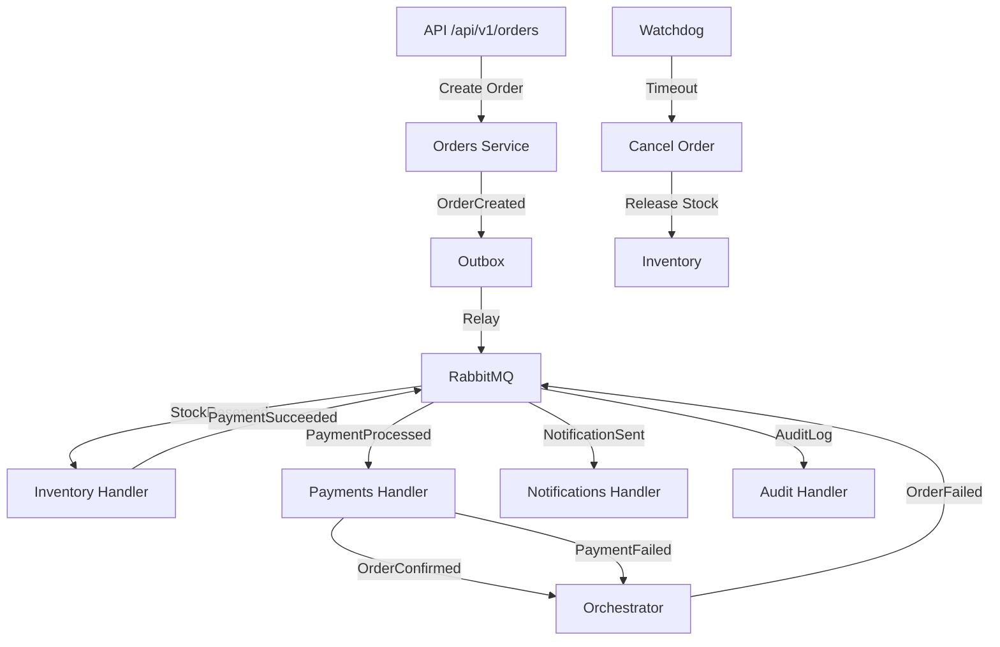

# Orquestra

[](https://github.com/gabri/orquestra/actions/workflows/ci.yml)
[](https://codecov.io/gh/gabri/orquestra)
[](https://www.python.org/downloads/)
[](https://www.djangoproject.com/)
[](https://opensource.org/licenses/MIT)

## Resumo

Plataforma de processamento de pedidos orientada a eventos com saga orquestrada, construída com Django, Celery, RabbitMQ e PostgreSQL.

A Orquestra implementa um padrão de saga orquestrada para gerenciar transações distribuídas de forma confiável, com mecanismos de retry, dead letter queue e compensação automática.

## Summary

Event-driven order processing platform with orchestrated saga pattern, built with Django, Celery, RabbitMQ, and PostgreSQL.

Orquestra implements an orchestrated saga pattern to manage distributed transactions reliably, with retry mechanisms, dead letter queue, and automatic compensation.

## Arquitetura



## Quick Start

```bash
# 1. Subir infraestrutura
uv run poe up

# 2. Rodar migrations e seed
uv run python manage.py migrate
uv run python manage.py seed_demo

# 3. Iniciar servidor
uv run python manage.py runserver
```

Acesse:
- **API**: http://localhost:8000/api/docs
- **Dashboard**: http://localhost:8000/
- **Health**: http://localhost:8000/health/detailed

## Kubernetes Deployment

For production deployment with Kubernetes:

```bash
# Build image
docker build -t orquestra:latest .

# Create kind cluster (local)
uv run poe k8s-kind-create

# Deploy
uv run poe k8s-apply

# Access at http://localhost:8000
```

See [docs/KUBERNETES.md](docs/KUBERNETES.md) for detailed deployment guide.

## Documentação

- [Arquitetura](docs/ARCHITECTURE.md)
- [Roadmap](docs/ROADMAP.md)
- [Runbook](docs/RUNBOOK.md)
- [ADRs](docs/adr/)

## Licença

MIT
