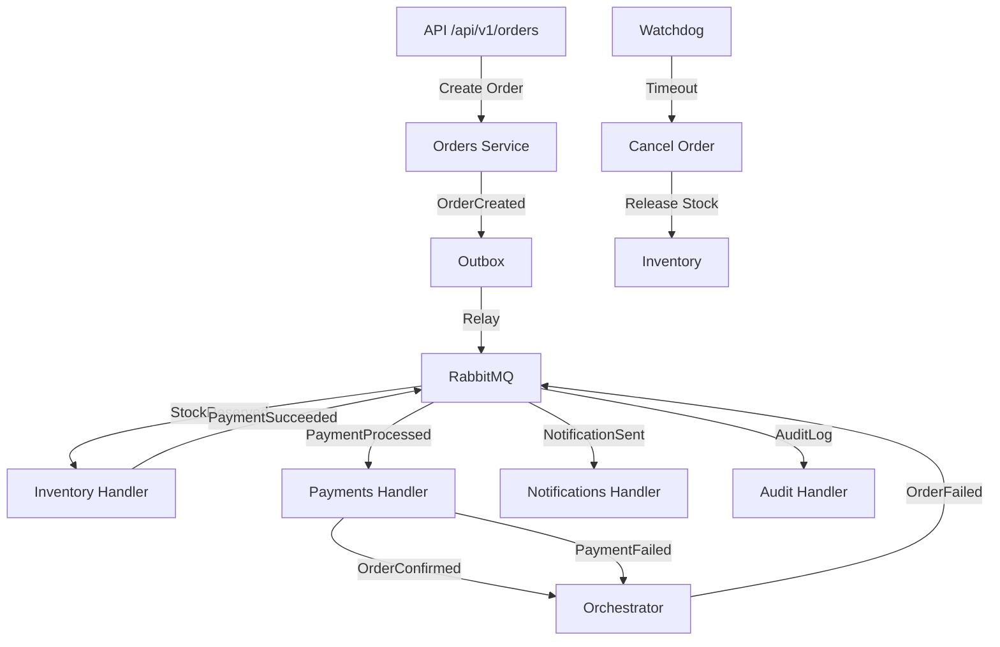

# Orquestra

[](https://www.python.org/downloads/)
[](https://www.djangoproject.com/)
[](https://opensource.org/licenses/MIT)
[](https://github.com/gabri/orquestra)

## Resumo

Plataforma de processamento de pedidos orientada a eventos com saga orquestrada, construída com Django, Celery, RabbitMQ e PostgreSQL.

A Orquestra implementa um padrão de saga orquestrada para gerenciar transações distribuídas de forma confiável, com mecanismos de retry, dead letter queue e compensação automática.

## Summary

Event-driven order processing platform with orchestrated saga pattern, built with Django, Celery, RabbitMQ, and PostgreSQL.

Orquestra implements an orchestrated saga pattern to manage distributed transactions reliably, with retry mechanisms, dead letter queue, and automatic compensation.

## Arquitetura



## Quick Start

```bash
# 1. Subir infraestrutura
uv run poe up

# 2. Rodar migrations e seed
uv run python manage.py migrate
uv run python manage.py seed_demo

# 3. Iniciar servidor
uv run python manage.py runserver
```

Acesse:
- **API**: http://localhost:8000/api/docs
- **Dashboard**: http://localhost:8000/
- **Health**: http://localhost:8000/health/detailed

## 📸 Screenshots

Tela login: 
Visão Geral: 
Pedidos: 
Falhas/DLQ: 
Laboratorio: 
Saúde: 


## 🎤 Como Fazer Demo para Entrevistas

### Demo Rápida (5 minutos)
```bash
# 1. Subir ambiente (já inclui migrations e seed)
uv run poe demo

# 2. Criar pedido via API
curl -X POST http://localhost:8000/api/v1/orders/ \
  -H "Idempotency-Key: demo-1" \
  -H "Content-Type: application/json" \
  -d '{"items": [{"sku": "PROD-001", "quantity": 2}]}'

# 3. Abrir dashboard e mostrar timeline
# http://localhost:8000/orders/<uuid>/
# Explicar: saga orquestrada, outbox, relay, workers

# 4. Mostrar observabilidade
# Jaeger: http://localhost:16686 (buscar trace do pedido)
# Grafana: http://localhost:3000 (dashboard orquestra)
```

### Demo Completa (20-30 minutos)
```bash
# 1. Mostrar arquitetura (5 min)
# - Explicar diagrama Mermaid no README
# - Mostrar bounded contexts (apps/)
# - Explicar communication via RabbitMQ

# 2. Demo do caminho feliz (5 min)
# - Criar pedido via API
# - Assistir saga no dashboard (timeline)
# - Mostrar traces no Jaeger
# - Explicar idempotência (repetir request)

# 3. Demo de falhas e compensação (10 min)
# - Acessar laboratório: http://localhost:8000/laboratory/
# - Criar pedido com estoque insuficiente
# - Assistir compensação automática
# - Criar pedido com pagamento recusado
# - Mostrar DLQ e replay manual

# 4. Demo de observabilidade (5 min)
# - Mostrar logs JSON com correlation_id
# - Mostrar métricas Prometheus
# - Mostrar dashboards Grafana
# - Explicar SLOs e alertas

# 5. Explicar decisões de arquitetura (5 min)
# - Por que saga orquestrada?
# - Por que transactional outbox?
# - Por que monólito modular?
# - Trade-offs considerados
```

### Perguntas para Engajar o Entrevistador
- "Você já trabalhou com sistemas event-driven?"
- "Como vocês lidam com idempotência em microservices?"
- "Vocês usam saga pattern? Qual abordagem?"
- "Qual stack de observabilidade vocês usam?"

### Cenários para Destacar
1. **Concorrência**: "Testei com 50 threads simultâneas - zero overselling"
2. **Resiliência**: "Gateway timeout → watchdog compensa automaticamente"
3. **Debugging**: "Trace completo no Jaeger em 3 cliques"
4. **Qualidade**: "90% cobertura, 235 testes, mypy strict, CI verde sempre"

## Consumidores RabbitMQ Alternativos

⚠️ **Nota Importante**: Este é um workaround temporário para um problema de routing key entre Celery e RabbitMQ. Para produção, recomenda-se investigar e corrigir a configuração do Celery. Veja [Troubleshooting](docs/TROUBLESHOOTING.md#0-celery-workers-não-funcionando) para mais detalhes.

Se o Celery tiver problemas de routing key ou configuração, use os consumidores alternativos que chamam handlers diretamente:

```bash
# Iniciar todos os consumidores alternativos
docker compose --profile alternative up -d

# Ou localmente
uv run python scripts/run_all_consumers.py

# Ou iniciar individualmente
uv run python scripts/consumer.py inventory
uv run python scripts/consumer.py payments
uv run python scripts/consumer.py notifications
uv run python scripts/consumer.py orchestrator
uv run python scripts/consumer.py audit
```

**Como funciona**:
- Mapeia filas RabbitMQ para handlers Celery por tipo de mensagem
- Chama handlers diretamente (bypass do routing key do Celery)
- Suporta múltiplos handlers por mensagem (fan-out)
- Usa idempotência via InboxMessage
- Fix encoding no Windows (UTF-8)

## Kubernetes Deployment

For production deployment with Kubernetes:

```bash
# Build image
docker build -t orquestra:latest .

# Create kind cluster (local)
uv run poe k8s-kind-create

# Deploy
uv run poe k8s-apply

# Access at http://localhost:8000
```

See [docs/KUBERNETES.md](docs/KUBERNETES.md) for detailed deployment guide.

## 🎯 Destaques Técnicos

### Padrões Avançados Implementados
- **Saga Orquestrada** - Coordenação de transações distribuídas com compensação automática
- **Transactional Outbox** - Garantia de consistência entre DB e broker de mensagens
- **Idempotência** - API (Idempotency-Key) e consumidores (Inbox pattern)
- **Retry com Backoff Exponencial + Jitter** - Resiliência contra falhas transitórias
- **Dead Letter Queue** - Isolamento de mensagens falhadas com replay manual
- **Circuit Breaker** - Timeout no watchdog para evitar sagas travadas
- **Hexagonal Architecture** - Separação entre ports (interfaces) e adapters (implementações)
- **Server-Sent Events (SSE)** - Real-time updates sem polling

### Stack Moderna e Production-Ready
- **Python 3.14** com type hints em todas as funções (mypy strict)
- **Django 6.1** com DRF, OpenAPI 3.0, JWT authentication
- **RabbitMQ 4.x** com quorum queues (alta disponibilidade)
- **PostgreSQL 18** com otimizações de performance
- **Celery 5.6** com delayed delivery nativo
- **OpenTelemetry** - Tracing distribuído (Django, Celery, psycopg, Redis)
- **Observabilidade completa** - Logs JSON (structlog), Prometheus, Grafana, Jaeger

### Qualidade de Código
- **Cobertura de testes**: 90%+ (235 testes unitários + integração)
- **Type safety**: mypy strict mode com Django/DRF stubs
- **Linting**: ruff com 50+ regras ativas
- **CI/CD**: GitHub Actions com lint, types, testes, security audit, Docker build
- **Pre-commit hooks**: ruff format, ruff check, mypy, pip-audit
- **Import-linter**: Garante isolamento entre bounded contexts

## 🏆 Próximos Passos Sugeridos

- Investigar e corrigir problemas de routing key do Celery para remover workaround de consumidores alternativos
- Adicionar mais testes de carga e stress testing
- Implementar feature flags para canary deployments
- Adicionar mais métricas de negócio customizadas no Grafana
- Explorar migração para microservices usando bounded contexts existentes

## 🏆 Desafios Técnicos Superados

### 1. Idempotência em Ambiente Distribuído
**Problema**: Como garantir que mensagens duplicadas não causem efeitos colaterais?

**Solução**:
- API: Header `Idempotency-Key` + hash do corpo com constraint UNIQUE no banco
- Consumidores: Tabela `InboxMessage` com UNIQUE(consumer, message_id)
- Garantia: Mesma mensagem processada múltiplas vezes = resultado idêntico

### 2. Consistência Entre DB e Broker
**Problema**: Como evitar perder mensagens se a transação commitar mas o broker falhar?

**Solução**:
- Transactional Outbox: Grava evento no DB na mesma transação do estado
- Relay processa eventos não-publicados e envia para RabbitMQ
- Se relay falhar, mensagem fica PENDING e é retomada no próximo ciclo

### 3. Sagas Travadas (Deadlock Lógico)
**Problema**: Pedidos ficam em estado intermediário por timeout de gateway

**Solução**:
- Watchdog Celery Beat roda a cada 5 minutos
- Detecta pedidos em PENDING há mais de 30 minutos
- Cancela pedido, libera estoque e notifica automaticamente
- Compensação garante consistência eventual

### 4. Overselling em Concorrência Alta
**Problema**: Múltiplas reservas simultâneas podem vender além do estoque

**Solução**:
- `SELECT FOR UPDATE` com database lock no produto
- Transação atômica reserva se quantidade disponível
- Testes de concorrência com 50 threads confirmam: sem overselling

### 5. Routing Key Celery vs RabbitMQ
**Problema**: Workers Celery não consumiam mensagens devido a routing keys incorretas

**Solução**:
- Consumidores alternativos RabbitMQ direto como workaround
- Mapeamento explícito fila → handler por tipo de mensagem
- Suporte a múltiplos handlers por mensagem (fan-out)
- Documentação detalhada em TROUBLESHOOTING.md

## 📚 O que Aprendi

### Arquitetura de Sistemas Distribuídos
- Diferença entre saga coreografada vs orquestrada
- Trade-offs de consistência forte vs eventual
- Padrões de resiliência: retry, circuit breaker, bulkhead, timeout
- CAP theorem na prática: escolha de CP vs AP por contexto

### Domain-Driven Design (DDD)
- Bounded contexts e comunicação assíncrona
- Aggregates e invariants
- Event-driven architecture e contrato de mensagens
- Ubiquitous language em código e documentação

### Observabilidade em Produção
- Distributed tracing com OpenTelemetry e Jaeger
- SLOs, SLIs e alertas baseados em métricas
- Logs estruturados vs logs não-estruturados
- Instrumentação automática vs manual

### Engineering Practices
- TDD vs BDD em projeto real
- Feature flags e canary deployments (teoria)
- GitOps e CI/CD pipelines
- Security: secrets management, dependency scanning

## 📊 Documentação

### Principal
- [Arquitetura](docs/ARCHITECTURE.md) - Visão geral da arquitetura e padrões
- [Roadmap](docs/ROADMAP.md) - Fases do projeto e progresso
- [Runbook](docs/RUNBOOK.md) - Guia de operação e troubleshooting básico
- [Contribuindo](CONTRIBUTING.md) - Guia para contribuidores

### Operação em Produção
- [Troubleshooting Avançado](docs/TROUBLESHOOTING.md) - Diagnóstico de problemas complexos
- [Performance Tuning](docs/PERFORMANCE.md) - Otimização de performance e scaling
- [Segurança em Produção](docs/SECURITY.md) - Hardening de segurança e best practices

### Deploy
- [Kubernetes](docs/KUBERNETES.md) - Deployment guide para Kubernetes
- [SSE Integration](docs/SSE.md) - Server-Sent Events para real-time updates

### Design
- [Design System](docs/DESIGN.md) - Tokens e componentes do dashboard
- [Screenshots Guide](docs/SCREENSHOTS.md) - Guia para capturar screenshots para portfólio

### ADRs
- [ADRs](docs/adr/) - Architecture Decision Records

### Para Recrutadores
- [Guia para Recrutadores](docs/RECRUITER_GUIDE.md) - Análise técnica detalhada do projeto
- [Preparação para Entrevistas](docs/INTERVIEW_PREP.md) - Como usar este projeto em entrevistas técnicas

## Licença

MIT
